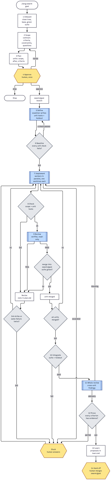

# zerg

An [agent skill](https://agentskills.io/specification) that runs a governed swarm of agents on one goal. You give
it a goal in plain language. It writes a contract and a plan, asks you to approve once, runs examiner, worker,
and verifier roles through test-first stages, and hands you a branch to merge.

It works in any agent that can run shell commands. A dependency-free Node script holds every gate, bound, and state change,
so the rules are enforced by code. The skill's instructions cover only the judgment work: planning, writing
tests, writing code, and reviewing it.



## Install

```sh
npx skills add tacoda/zerg            # into this project, for the agents you pick
npx skills add tacoda/zerg -g         # for every project
npx skills check                      # see whether a newer zerg is out; run `add` again to update
```

It needs git, Node.js 18 or later, and a repo whose test suite runs from one command. If you installed it with
`npx skills`, you already have Node.

## Use it

Ask your agent to run zerg on a goal:

```
Use zerg to add a CSV export to the reports page.
Resume zerg goal G-csv-export.
Review my zerg lessons.
```

You're asked three things at most:
- **Approve** the plan. At this point you can also choose `auto`, which drops stuck units instead of asking.
- **Answer** a stuck unit.
- **Merge** the branch.

To stop new work at any time, run `touch .swarm/STOP`.

## What it does, in order

| # | Stage | Who | Enforced by `swarm.mjs` |
|---|---|---|---|
| 1 | Onboard: clean tree, base branch, green suite | orchestrator | `approve` |
| 2 | Scope: observable criteria, constraints, grep criteria with owners | orchestrator | `lint` |
| 3 | Plan: units, non-overlapping scope, `after` dependencies | orchestrator | `lint` |
| 4 | Approve, choosing `ask` or `auto` | you | `summary`, `approve` |
| 5 | Define: unit tests (committed), holdout tests (hidden), findings | examiner | `define`, `amend` |
| 6 | Baseline: every unit's tests fail first | orchestrator | `baseline` |
| 7 | Implement: one unit per worktree, in parallel | worker | `lease`, `report` |
| 8 | Check: diff in scope, unit tests pass | orchestrator | `check` |
| 9 | Review, then merge into `swarm/<goal>` | verifier | `review`, `merge` |
| 10 | Integrate: full suite and holdout | orchestrator | `integrate` |
| 11 | Whole review: cross-unit findings, one fix unit | verifier | `review whole`, `add-fix` |
| 12 | Prove: every criterion has a passing evidence command | orchestrator | `prove` |
| 13 | Learn: lessons split into two lanes and routed | orchestrator | `stage learned` |
| 14 | Hand off with token cost; you merge | you | `handoff` |

`swarm.mjs next` is the derive table: the agent runs it, does the one action it prints, and runs it again.

## Roles in any agent

The examiner, worker, and verifier are files in `skills/zerg/references/`. `swarm.mjs brief` prints the
whole handoff for one role: a few identifiers and the path to its role file, never a summary of the run.
- **Agents with subagents** give each brief to a fresh subagent. Workers and verifiers run in parallel.
- **Agents without subagents** play each role in turn. That works, but one agent reviewing its own code is
  weaker than two, and the hand-off says so.

Each role records its own result through the script (`define`, `report`, `review`), so the orchestrator never parses free text.

## What the code guarantees

- **One writer at a time:** every state change takes `.swarm/.lock`, so parallel agents can't lose updates.
- **Isolation:** every worker gets its own worktree and branch, and `lint` keeps their scopes from overlapping.
- **Fail-first tests:** tests come from the examiner and must fail before work starts. A worker's diff must stay inside its scope.
- **Never trust a report:** `report produced` needs commits, `check` runs the tests itself, and `merge` needs a recorded pass.
- **Checks don't repair:** a verifier's edits are restored, and its verdict is refused.
- **Holdout stays hidden:** the holdout tests and their command live in a gitignored folder that no worktree contains.
- **Two strikes:** a third failure, or the same failure word for word, makes a unit stuck.
- **Bounds:** no-progress, iteration, and token limits, plus `.swarm/STOP`.
- **Nothing merges into your base branch.**

## How it learns without an upgrade

There are three rule layers. A later layer wins where two disagree:

| Layer | Where | Written by | Survives an update? |
|---|---|---|---|
| Defaults | the installed skill | a zerg release | replaced |
| User rules | `~/.zerg/rules.md` (`$ZERG_HOME`) | you, by accepting lessons | yes |
| Project rules | `.swarm/LEARNINGS.md` | the swarm, at the learn stage | yes, and it's committed |

Each goal ends with lessons in two lanes. Project lessons go straight to `.swarm/LEARNINGS.md`.
Lessons about zerg itself go to `~/.zerg/inbox.md`. When you ask your agent to review them, it accepts each one
you approve into `rules.md`, or into `~/.zerg/config` if it changes a bound.

Rules change what the roles are told. They can't loosen what the script enforces; that takes a release.

## Develop

```sh
npm test      # unit tests, the agentskills spec check, and the full lifecycle on a throwaway repo
```

The script has no dependencies and no build step. It uses `// @ts-check` with JSDoc types, so your editor
type-checks it as you work.

For live edits while you work, symlink the skill into your agent's skills directory. For Claude Code, that's
`ln -s "$PWD/skills/zerg" ~/.claude/skills/zerg`. `npx skills add ./ ` does the same for other agents.

## Where it came from

The stage order follows the wipp factory. The loop discipline follows `/drive` from parento-portal: a derive
table, identifier handoffs, two-strike and no-progress bounds, an interrupt protocol, and a cost report.

## License

MIT. See [LICENSE](LICENSE).
